# Informe: puntos 1, 2, 3 y 4

Ejercicios 1–4 de Ball Pivoting en C++ y OpenGL/GLUT.

| Punto | Código | Capturas |
|---|---|---|
| 1. Malla 2D | [Fuente](BallPivoting2D_Malla_OpenGL.cpp) | 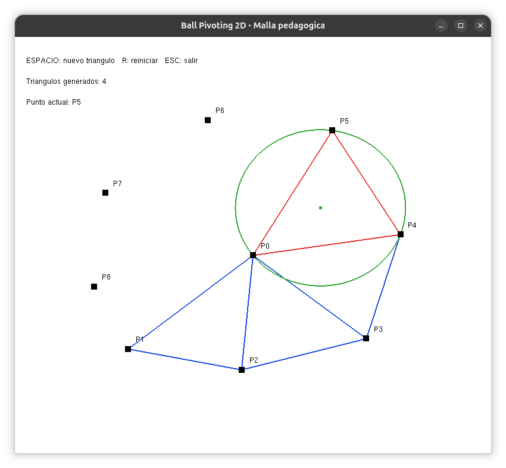 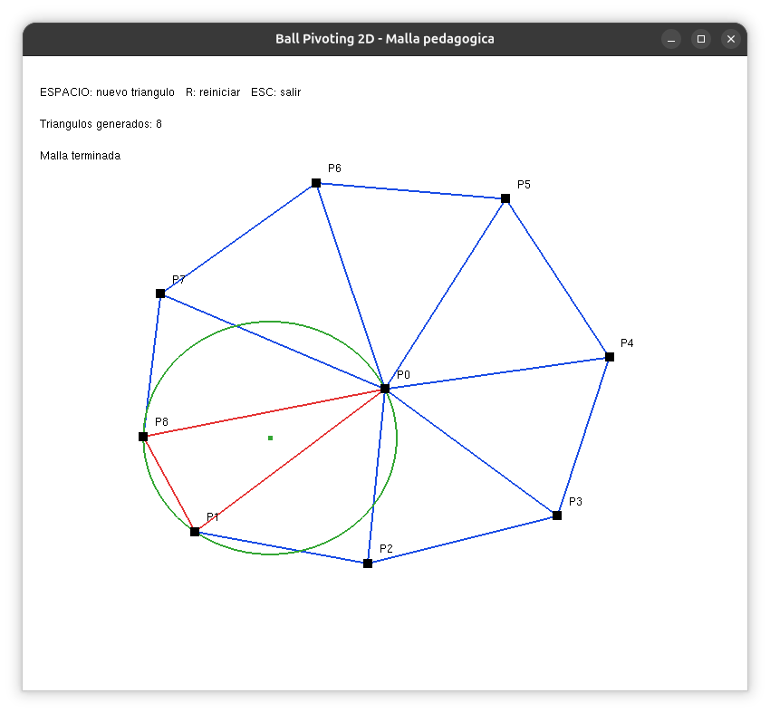 |
| 2. Escena 3D rotada | [Fuente](BallPivoting3D_Pedagogico_OpenGL.cpp) | 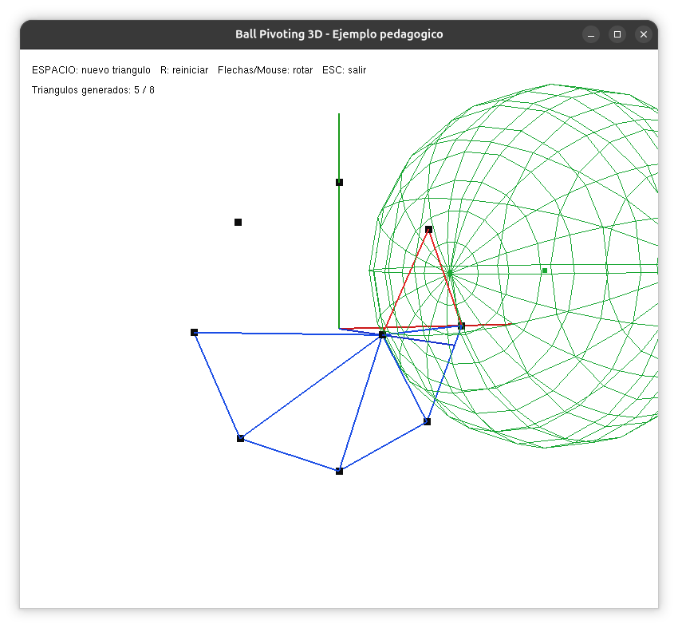 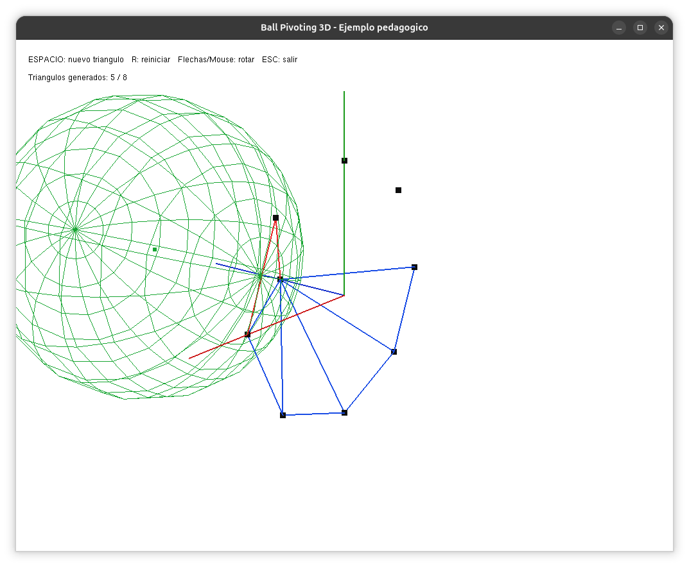 |
| 3. Bunny: puntos y malla | [Fuente](01_Visualizador_Stanford_Bunny_CENTRADO.cpp) | 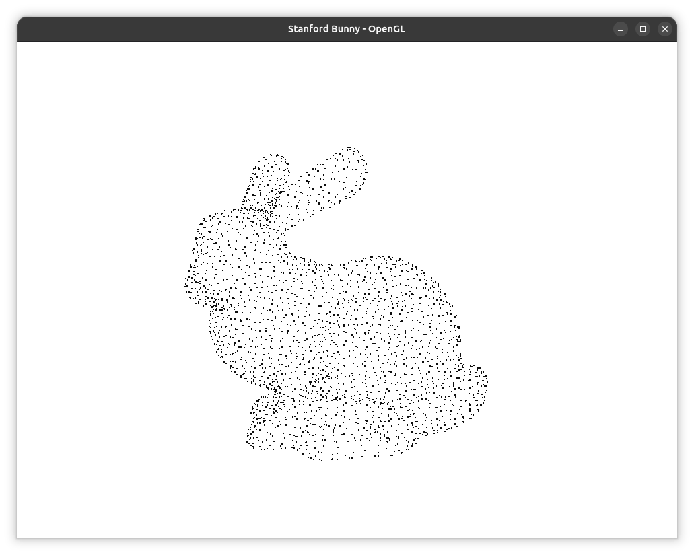 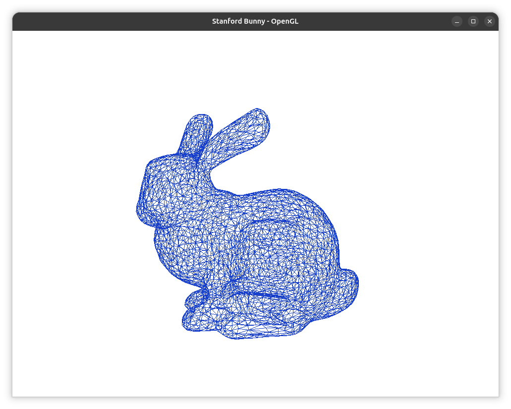 |

## 4. Radios con 2503 puntos

[Código](02_Stanford_Bunny_BPA_2503_CENTRADO.cpp). Teclas **1**, **2**, **3**: cambiar radio; **W**: malla; **F**: sólido.

| Radio | Triángulos | Observación | Captura |
|---|---:|---|---|
| 0.005 | 6271 | Huecos en base y espalda. | 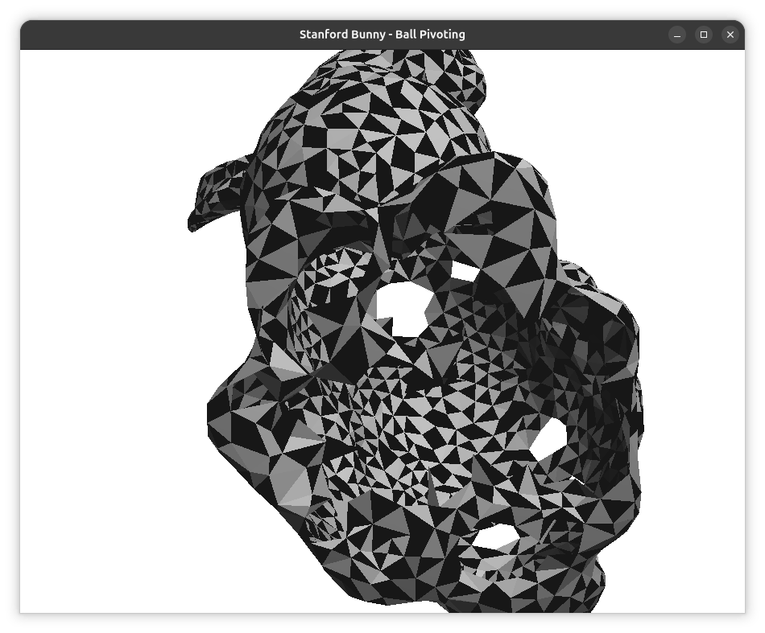 |
| 0.007 | 6564 | Persisten huecos más pequeños. | 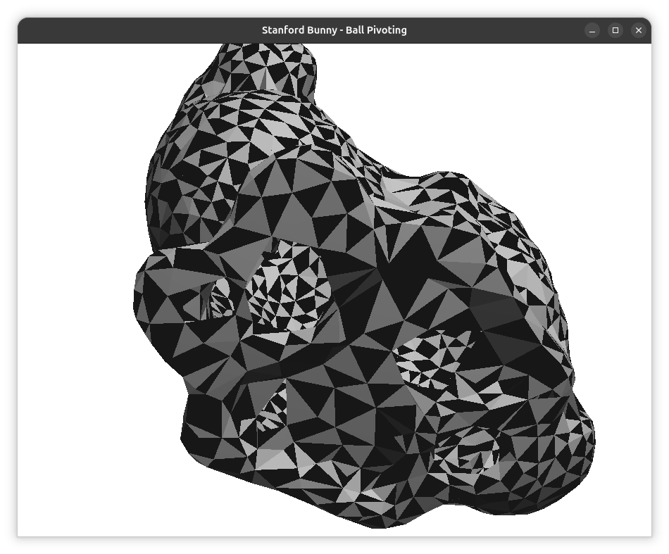 |
| 0.010 | 6476 | Sin huecos visibles en la vista capturada; mejor resultado visual observado. | 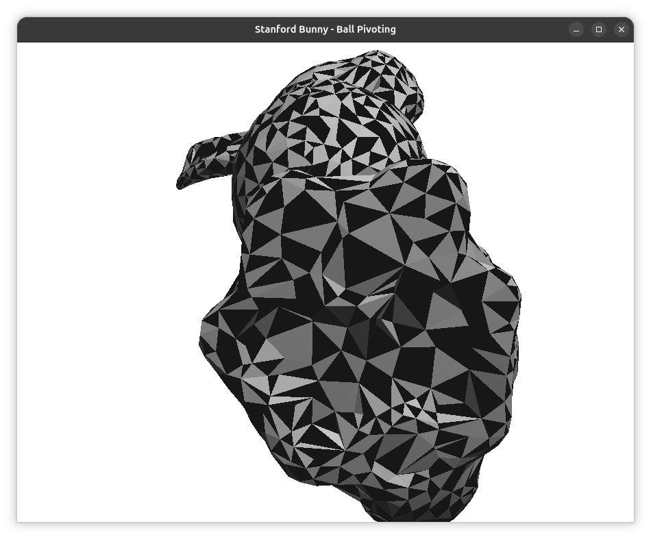 |

<details>
<summary>Detalles de los huecos</summary>

| Malla, radio 0.005 | Espalda, radio 0.005 | Malla, radio 0.007 |
|---|---|---|
| 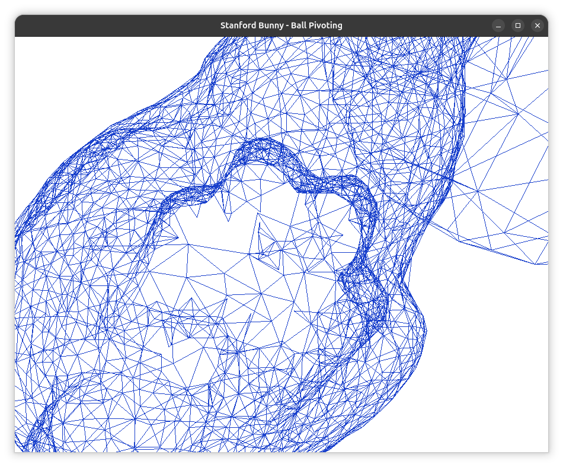 | 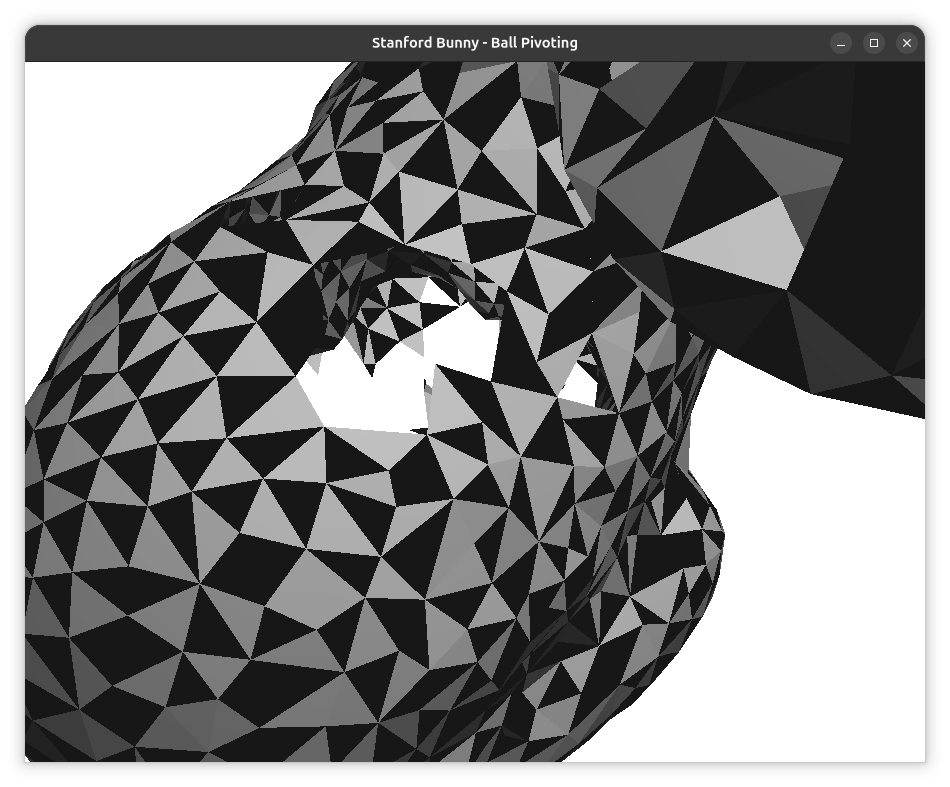 | 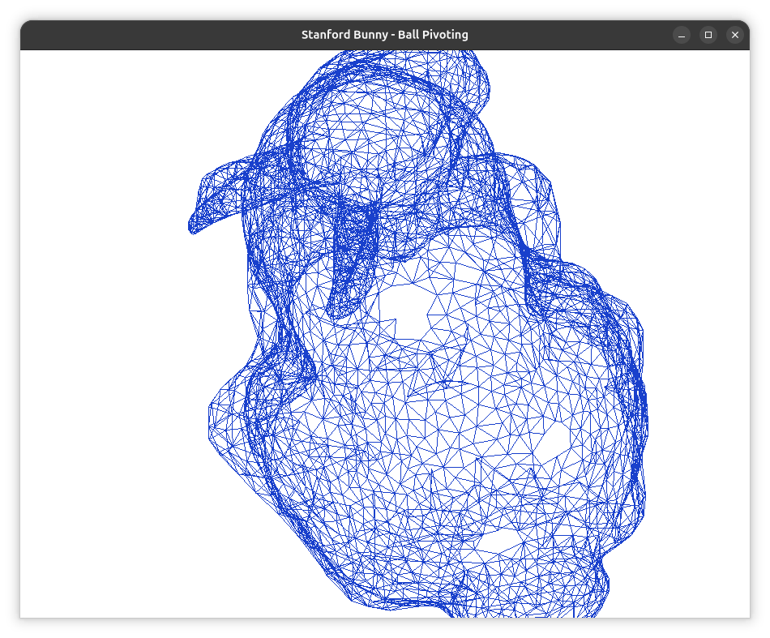 |

</details>

## Compilación

Requiere `g++`, OpenGL y FreeGLUT. Sustituir `archivo.cpp` por el fuente elegido y ejecutar desde esta carpeta:

```bash
g++ -std=c++11 archivo.cpp -o programa -lGL -lGLU -lglut
./programa
```

Los puntos 5–7 están en [su informe](INFORME_PUNTOS_5_6_7.md). Mediciones existentes: `make run-2503` y `make run-20000`.

Modelo: Stanford University Computer Graphics Laboratory.
